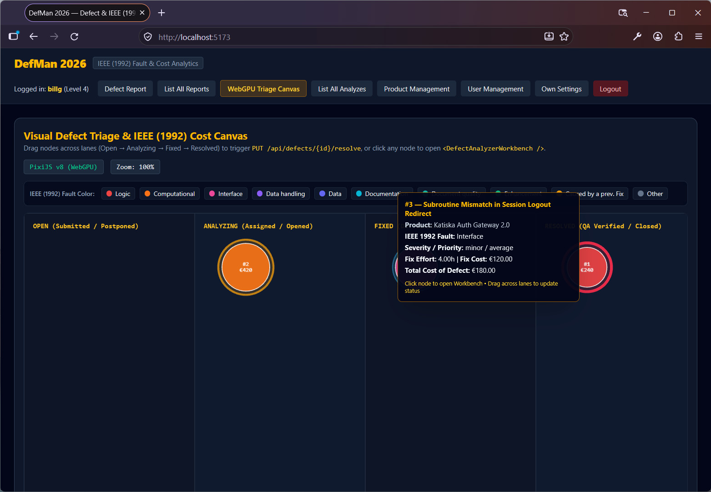
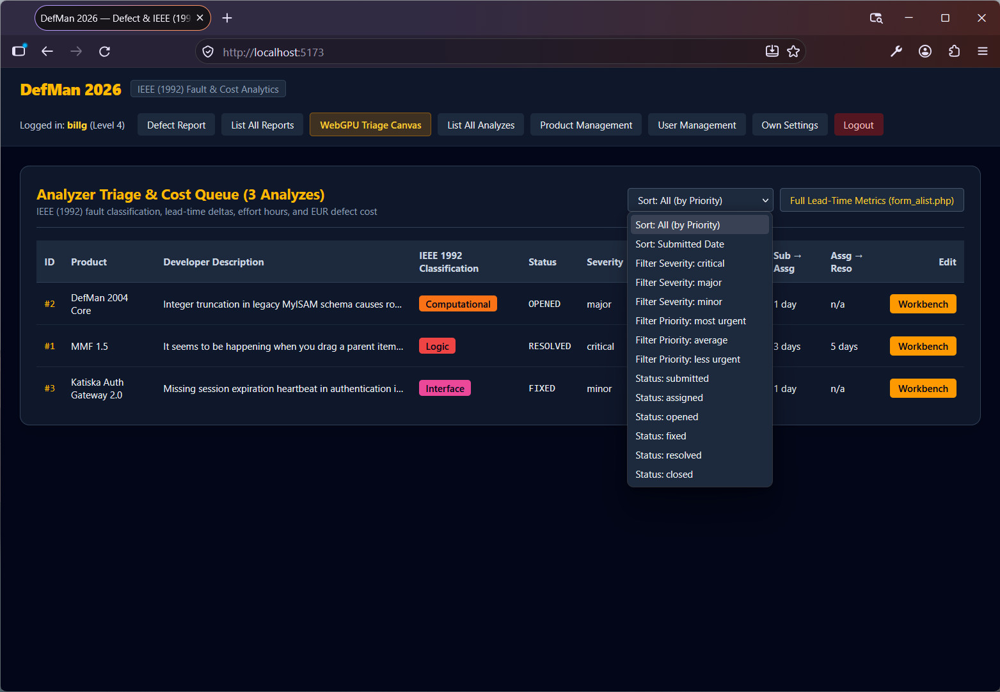
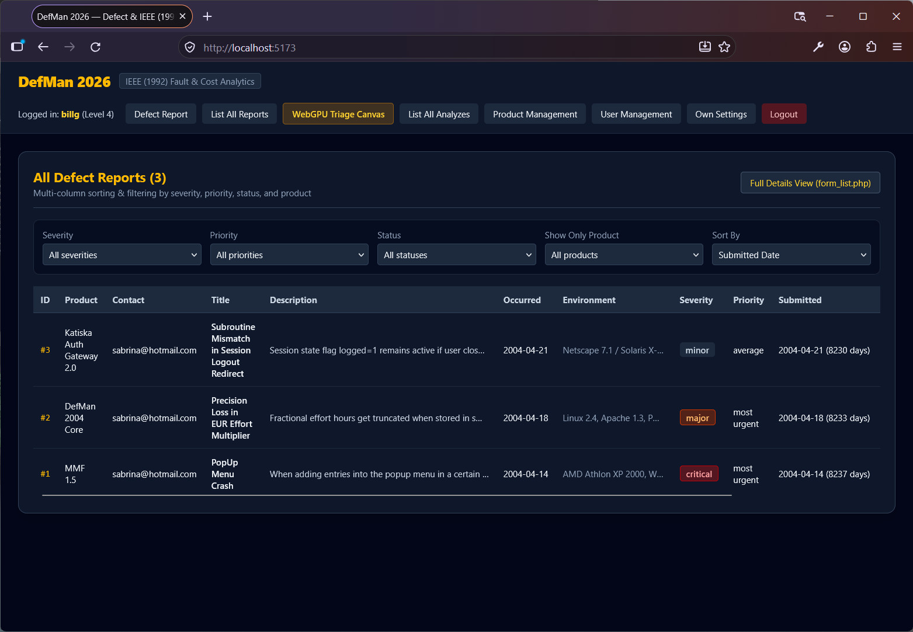
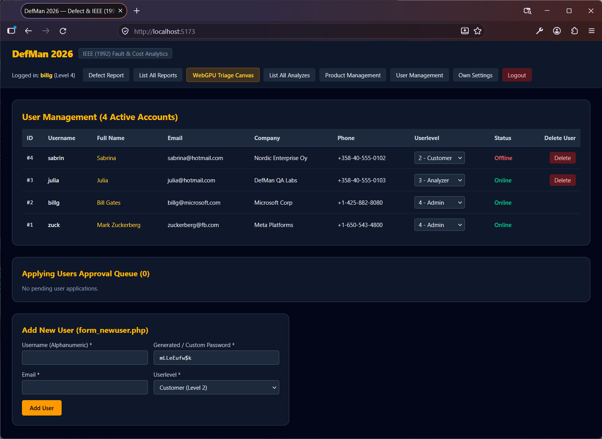
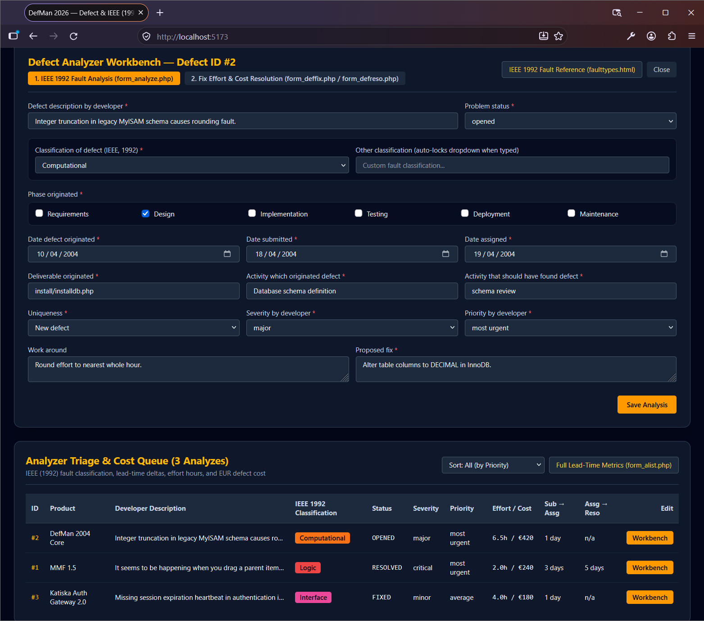

# DefMan (Defect Manager) — 2026 Full-Stack Modernization

**Original Completion Date:** April 14, 2004  
**Modernization Release:** 2026 (PHP 8.3+ REST API • MySQL 8 InnoDB • React 19 + TypeScript • PixiJS v8 WebGPU)

Welcome to **DefMan (Defect Manager) — 2026 Edition**! This repository contains the **2026 Modernized Architecture** of the historical 2004 DefMan bug and fault cost tracking system: a complete full-stack migration from the [original 2004 archival codebase (`defman-2004-archive`)](https://github.com/lassesali/defman-2004-archive) (HTML 4.01 `<table>` layouts, `<?` short tags, `mysql_*` functions) into a decoupled **PHP 8.3+ PDO REST API**, a **MySQL 8.0+ InnoDB Schema**, a **React 19 (Vite + TypeScript) SPA**, and a **PixiJS v8 (WebGPU/WebGL2)** visual defect triage & IEEE (1992) fault cost analytics canvas.

---

## 📸 Screenshots & Interface Gallery

### 1. Interactive WebGPU Triage & IEEE (1992) Cost Canvas

*Figure 1: Hardware-accelerated PixiJS v8 (WebGPU) triage board displaying defects across lifecycle lanes (`OPEN`, `ANALYZING`, `FIXED`, `RESOLVED`). Node radius scales dynamically with total EUR defect cost, outer ring thickness reflects developer fix effort, and node color maps to its IEEE 1044-1992 fault classification. Hovering reveals real-time cost and effort breakdowns.*

### 2. Analyzer Triage & Cost Queue

*Figure 2: The Analyzer Queue (`form_queue.php` / `form_alist.php` modernization) featuring IEEE 1992 fault badges, lead-time delta metrics (`Sub -> Assg` and `Assg -> Reso`), and instant 14-mode sorting and filtering across severity, priority, and lifecycle status.*

### 3. Multi-Column Defect Report Grid

*Figure 3: Comprehensive defect report overview (`form_list.php` modernization) with multi-dimensional filtering by severity, priority, status, and software product, alongside automated submission age calculation.*

### 4. Role-Based User Management & Approval Queue

*Figure 4: Level 4 Administrator dashboard for managing active accounts, toggling RBAC privilege tiers (Customer, Analyzer, Admin), monitoring Katiska session online presence, and provisioning new users with auto-generated credentials.*

### 5. Defect Analyzer Workbench (IEEE 1044-1992 Classification)

*Figure 5: The two-stage Defect Analyzer Workbench (`form_analyze.php` & `form_deffix.php` / `form_defreso.php`) enabling root-cause SDLC phase tracking, IEEE 1992 fault classification with mutual-exclusion custom overrides, and precision EUR cost accounting.*

---

## ✨ Key Features

* **Full Legacy Workflow Parity (DefMan 2004 + Katiska 2004)**:
  * **Public / Anonymous Defect Reporting** (`PublicReportForm.tsx`) & **Public Registration Application** (`form_apply.php` parity).
  * **Customer Defect Reporting** (`CustomerReportForm.tsx` with auto-prefilled reporter contact info).
  * **Multi-Column Defect Report Grid** (`DefectReportGrid.tsx`) with combined filter dropdowns (Severity, Priority, Status, Product, Sort) and full-detail modal views (`DefectDetailModal.tsx`).
  * **Analyzer Triage & Cost Queue** (`AnalyzerQueue.tsx`) with **14-option combined Sort/Filter selector**, lead-time delta metrics (`Sub -> Assg`, `Assg -> Reso`), and toggleable **Full Lead-Time Metrics** view (`form_alist.php` parity).
  * **Two-Tab Defect Analyzer Workbench** (`DefectAnalyzerWorkbench.tsx` + `DefectResolutionForm.tsx`):
    * **Tab 1 (`form_analyze.php`)**: IEEE 1044-1992 fault classification with mutual-exclusion custom classification override, SDLC phase checkboxes, origination/submission/assignment dates, deliverable/activity tracking, and built-in **IEEE 1992 Fault Reference Modal (`faulttypes.html`)**.
    * **Tab 2 (`form_deffix.php` + `form_defreso.php`)**: Fix effort hours (`DECIMAL(8,2)`), fix cost (`EUR`), total cost of defect (`EUR`), resolution status (`fixed`, `resolved`, `closed`, `postponed`), and audit attribution.
  * **Interactive PixiJS v8 WebGPU Triage Canvas** (`DefectTriageCanvas.tsx`):
    * Drag-and-drop nodes across **Open -> Analyzing -> Fixed -> Resolved** swimlanes to trigger live `PUT /api/defects/{id}/resolve` updates.
    * Visualizes **Total Cost of Defect (EUR)** via node radius, **Fix Effort (Hours)** via outer ring stroke, and **IEEE (1992) Fault Classification** via color-coded nodes.
  * **Product Catalog Management** (`ProductManager.tsx` — Level 3/4) with inline editing and safety checks against deleting products with linked defect reports.
  * **User Management & Approval Queue** (`AdminUserApproval.tsx` — Level 4) with `applying_users` approval/rejection, role updates, online status indicators, and random 10-character password generator (`form_newuser.php` parity).
  * **Self-Service Profile & Password Settings** (`UserProfileSettings.tsx` — Level 2/3/4).

---

## ⚡ Quick Start (Docker Compose — Recommended)

Everything (MySQL 8.0+ schema + seed data, PHP 8.3 Apache REST API, and Vite React 19 + PixiJS v8 frontend) starts with a single command:

```bash
docker compose up --build
```

* **Frontend UI**: [http://localhost:5173](http://localhost:5173)
* **Backend REST API**: [http://localhost:8080/api](http://localhost:8080/api)

### Local CLI Setup (Alternative)

1. **Provision MySQL 8 Schema & Seed Data:**
   ```bash
   mysql -u root -p opr0413 < database/schema.sql
   php backend/bin/seed.php
   ```

2. **Start the PHP 8.3+ REST API:**
   ```bash
   php -S localhost:8080 -t backend/public
   ```

3. **Start the React 19 + PixiJS v8 WebGPU SPA:**
   ```bash
   cd frontend
   npm install
   npm run dev
   ```

---

## 🔐 Seeded Test Accounts (`DatabaseSeeder.php`)

| Role (RBAC Level) | Username | Email | Default Password |
| :--- | :--- | :--- | :--- |
| **Admin (Level 4)** | `zuck` | `zuckerberg@fb.com` | `Admin#2026!Zuck` |
| **Admin / System (Level 4)** | `billg` | `billg@microsoft.com` | `System#2026!Bill` |
| **Analyzer (Level 3)** | `julia` | `julia@hotmail.com` | `Analyze#2026!Julia` |
| **Customer (Level 2)** | `sabrin` | `sabrina@hotmail.com` | `Cust#2026!Sabrina` |

---

## 🚀 2026 Modernization Architecture

### Directory Structure

```text
.
├── docker-compose.yml                           # Docker Compose orchestration (MySQL 8 + PHP 8.3 API + Vite React 19)
├── database/
│   └── schema.sql                               # MySQL 8.0+ InnoDB DDL (utf8mb4_unicode_ci, Foreign Keys, Indexes)
├── backend/
│   ├── Dockerfile                               # PHP 8.3 Apache container with PDO MySQL & rewrite routing
│   ├── .dockerignore                            # Docker build context exclusions
│   ├── docker-entrypoint.sh                     # Container entrypoint (waits for DB readiness & auto-seeds)
│   ├── bin/
│   │   └── seed.php                             # CLI Database Seeder runner (`--if-empty` idempotency support)
│   ├── public/
│   │   ├── .htaccess                            # Apache rewrite & Bearer Authorization header passthrough
│   │   └── index.php                            # PHP 8.3 REST API Front Controller & Router
│   └── src/
│       ├── Database/
│       │   └── DatabaseSeeder.php               # PDO Seeder (Admin/System, Analyzer, Customer & IEEE 1992 defects)
│       ├── Domain/Enum/
│       │   ├── IeeeFaultType.php                # Native PHP 8.3 Backed Enum for IEEE (1992) Fault Classifications
│       │   └── DomainEnums.php                  # UserLevel, DefectSeverity, DefectPriority, DefectStatus, OriginPhase
│       ├── Infrastructure/Database/
│       │   └── Database.php                     # Strict-typed PDO Singleton (ERRMODE_EXCEPTION, prepared statements)
│       ├── Repository/
│       │   ├── UserRepository.php               # Argon2id auth, random_bytes(32) sessions & password recovery
│       │   ├── ProductRepository.php            # Product catalog CRUD & defect counts
│       │   ├── DefectRepository.php             # Multi-column sorting, filtering & deleted-user preservation
│       │   └── AnalysisRepository.php           # IEEE 1992 triage, lead-time delta metrics, effort (h) & EUR cost
│       └── Http/
│           ├── Middleware/
│           │   └── RbacMiddleware.php           # Enforces Level 1 (Public) to Level 4 (Admin) RBAC
│           └── Controller/
│               ├── AuthController.php           # Login, Logout, User Application, Password Recovery
│               ├── UserController.php           # Admin Approval Queue, Role Assignment, User Profile Settings
│               ├── DefectController.php         # Public/Customer Reporting, Analyzer Queue, Triage & Resolution
│               └── ProductController.php        # Product Management CRUD
├── frontend/
│   ├── Dockerfile                               # Node 22 Vite + React 19 + PixiJS v8 frontend container
│   ├── .dockerignore                            # Frontend Docker build exclusions
│   ├── package.json                             # React 19, PixiJS v8, Tailwind CSS v4 & Vite dependencies
│   ├── vite.config.ts                           # Vite server configuration (port 5173)
│   └── src/
│       ├── types/defman.ts                      # TypeScript Enums (IeeeFaultType, UserLevel, etc.) & DTOs
│       ├── api/client.ts                        # Typed Fetch REST Client with Bearer Token Auth
│       ├── App.tsx                              # React 19 SPA Shell & Role-Aware Navigation
│       └── components/
│           ├── PublicReportForm.tsx             # Level 1 Public defect submission + inline help modal
│           ├── CustomerReportForm.tsx           # Level 2+ Customer defect submission
│           ├── DefectReportGrid.tsx             # Multi-column sorting/filtering grid & full-details toggle
│           ├── DefectDetailModal.tsx            # Report inspector & editor modal
│           ├── AnalyzerQueue.tsx                # Level 3 Analyzer triage table & 5 lead-time delta metrics
│           ├── DefectAnalyzerWorkbench.tsx      # IEEE (1992) fault classification, origin phase & fix workbench
│           ├── DefectResolutionForm.tsx         # Effort hours, EUR/h rate helper, fix cost & total defect cost
│           ├── DefectTriageCanvas.tsx           # PixiJS v8 (WebGPU/WebGL) 2D interactive triage & cost canvas
│           ├── AdminUserApproval.tsx            # Level 4 Admin user management & pending applicant approval queue
│           ├── ProductManager.tsx               # Level 4 Admin product catalog CRUD
│           └── UserProfileSettings.tsx          # Password, email, and personal profile settings
├── DefMan-2026-Implementation-Document.pdf      # Complete exported implementation reference (PDF)
├── DefMan-2026-Implementation-Document.txt      # Complete exported implementation reference (TXT)
├── LICENSE                                      # Project license
└── README.md                                    # Project documentation
```

---

### 🗺️ 2004 Legacy-to-2026 Modern File Mapping

| Legacy 2004 File(s) | Modernized 2026 Layer | Key Upgrades |
| :--- | :--- | :--- |
| `install/installdb.php`, `install-part1.php`, `install-part2.php` | `database/schema.sql` & `DatabaseSeeder.php` | `MyISAM` → `InnoDB`, `utf8mb4_unicode_ci`, Foreign Keys, `DECIMAL` cost columns, PDO Seeder |
| `config.php`, `dbconnect.php`, `db.php` | `Database.php` & `*Repository.php` | Removed `<?` short tags & `mysql_*` calls; strict-typed PHP 8.3 PDO prepared statements |
| `defecttype.txt`, `faulttypes.html` | `IeeeFaultType.php` & `types/defman.ts` | Native PHP 8.3 Backed Enum & TypeScript Enum with IEEE (1992) taxonomy & hex colors |
| `login.php`, `logout.php`, `randompassword.php`, `form_lostpassword.php` | `AuthController.php` & `RbacMiddleware.php` | Plaintext passwords → `password_hash(..., PASSWORD_ARGON2ID)` & `random_bytes(32)` tokens |
| `form_raportpub.php` (+ `helpreportpub.html`) | `<PublicReportForm />` (`POST /api/defects/public`) | Level 1 unauthenticated defect reporting with inline help example |
| `form_raport.php` (+ `helpreport.html`) | `<CustomerReportForm />` (`POST /api/defects`) | Level 2+ authenticated customer defect reporting |
| `form_raportlist.php`, `form_list.php` | `<DefectReportGrid />` (`GET /api/defects`) | Multi-column sorting, filtering, `[DELETED USER]` badge & summary/full-details toggle |
| `form_defrap.php` | `<DefectDetailModal />` (`GET/PUT /api/defects/{id}`) | Modal report viewer/editor with direct jump to Analyzer Workbench |
| `form_alist.php`, `form_analyzed.php` | `<AnalyzerQueue />` (`GET /api/analyzer/queue`) | Computes `Submitted→Assigned`, `Submitted→Fixed`, `Submitted→Resolved`, `Assigned→Fixed`, `Assigned→Resolved` |
| `form_analyze.php` (+ `helpanalyze.html`) | `<DefectAnalyzerWorkbench />` (`PUT /api/defects/{id}/analyze`) | IEEE (1992) fault classification, `Other` custom override, lifecycle phase checkboxes |
| `form_deffix.php`, `form_defreso.php` | `<DefectResolutionForm />` (`PUT /api/defects/{id}/resolve`) | Logs fix description, effort hours (`fixeffort`), fix cost (`fixcost` €), and total defect cost (`costofdefect` €) |
| `form_usermanagement.php`, `form_apply.php`, `form_newuser.php` | `<AdminUserApproval />` (`GET/POST/PATCH/DELETE /api/admin/users`) | Admin user table, online/offline indicator, applicant approval/decline workflow |
| `form_productdetails.php` | `<ProductManager />` (`GET/POST/DELETE /api/admin/products`) | Admin product catalog CRUD with report counts |
| `form_userdetails.php` | `<UserProfileSettings />` (`GET/PUT /api/users/me`) | Self-service password, email, and personal settings |
| *New in 2026* | `<DefectTriageCanvas />` (PixiJS v8 WebGPU) | 2D interactive defect & cost canvas with drag-and-drop lane triage |

---

## 🕰️ Historical Context
Originally completed on April 14, 2004 (at the University of Kuopio, Finland) using PHP 4 (`mysql_*` functions and `<?` short tags), MySQL `MyISAM`, and HTML 4.01 `<table>` layouts, DefMan has been fully re-architected in 2026 into a modern PHP 8.3+ PDO REST API, MySQL 8 InnoDB schema, and React 19 + PixiJS v8 WebGPU frontend while preserving all original domain logic, RBAC levels, and IEEE (1992) fault classification workflows. The unmigrated 2004 version is preserved in the [`lassesali/defman-2004-archive`](https://github.com/lassesali/defman-2004-archive) repository.

---

## 📄 License
This project is licensed under the **MIT License** — see the [LICENSE](LICENSE) file for details.

Copyright (c) 2026 Lasse Sali.
