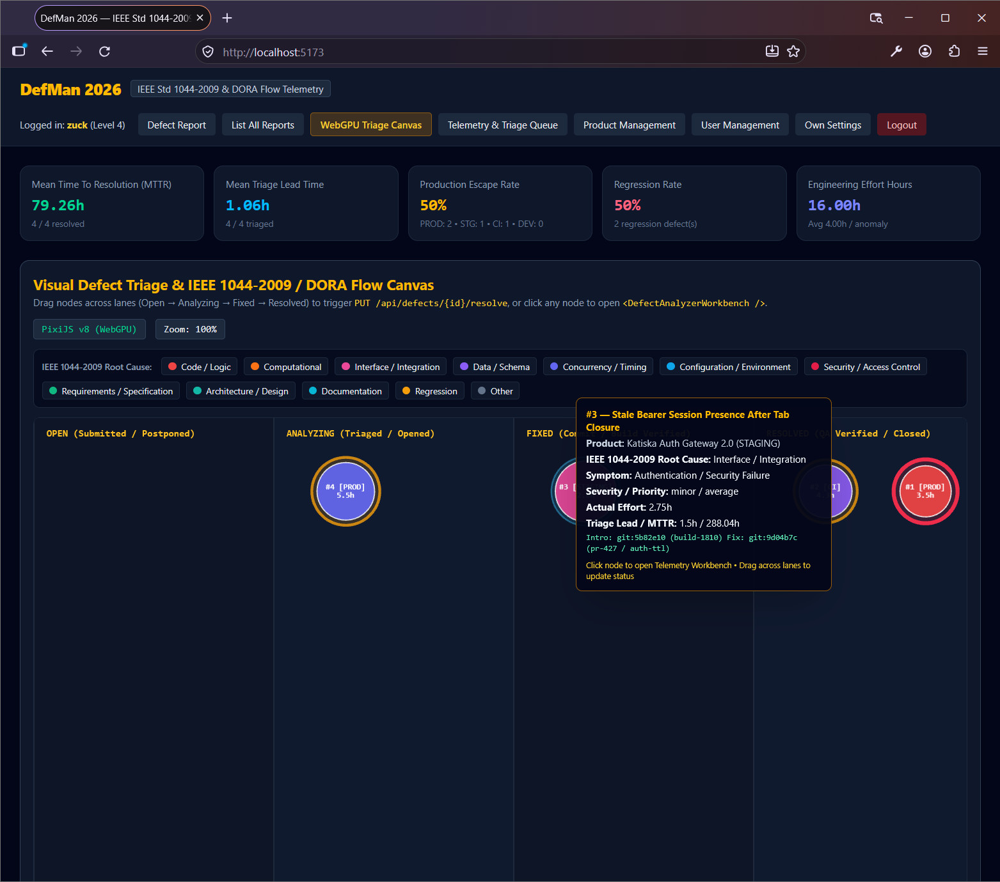
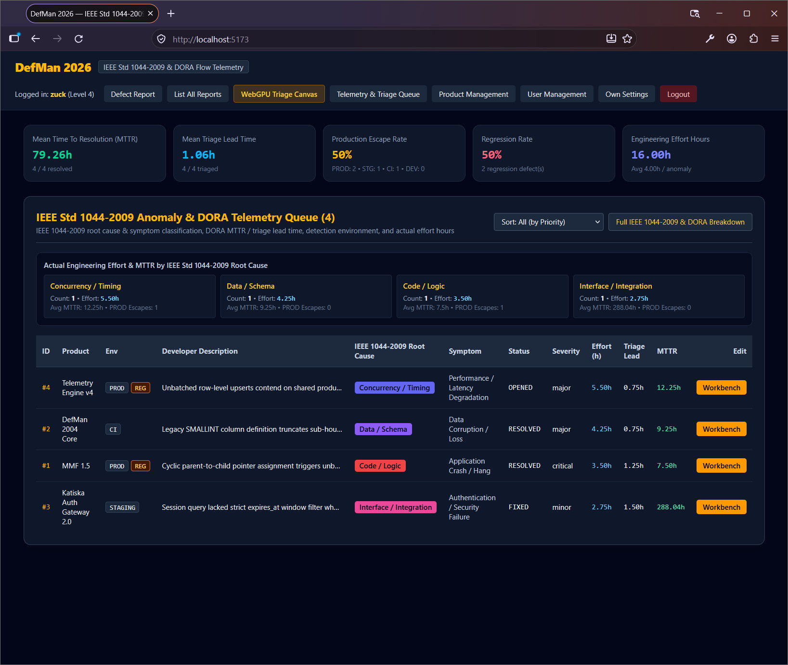
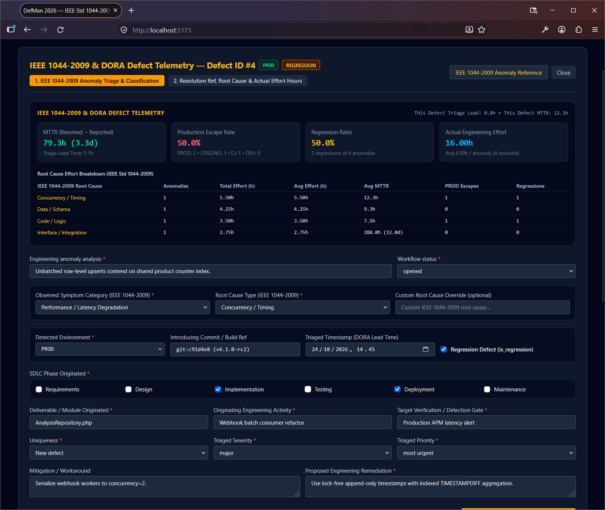
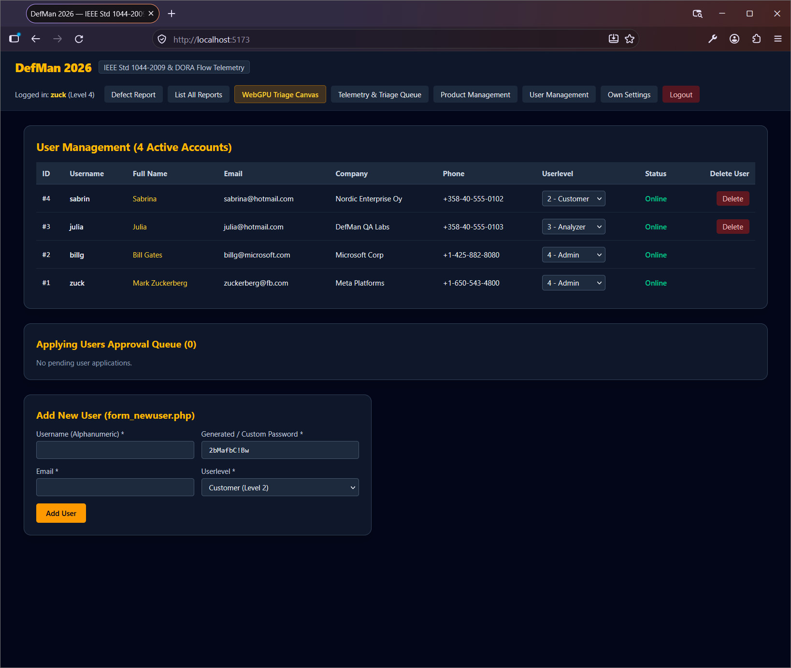
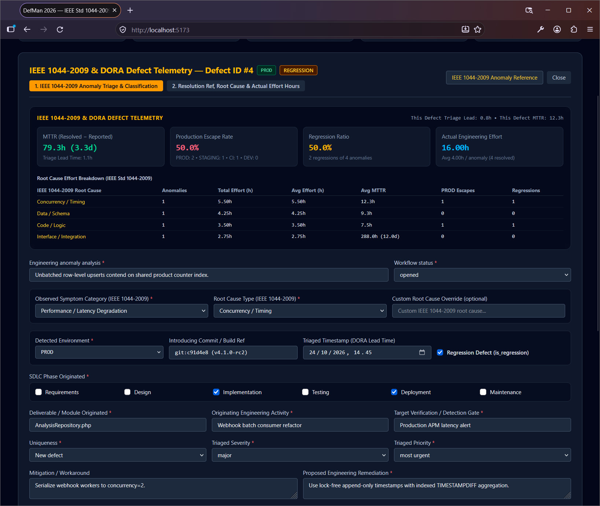
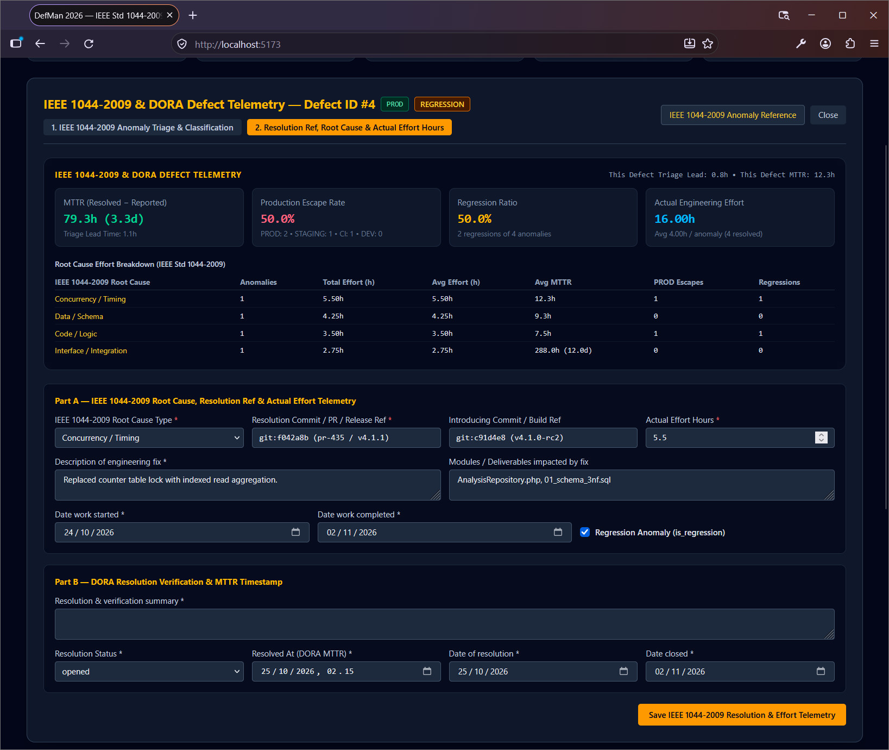
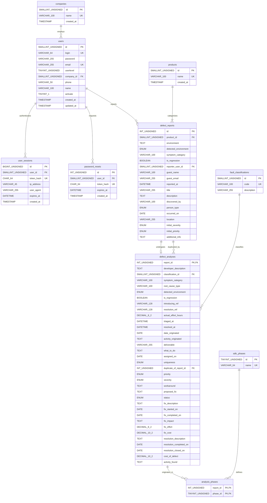

# DefMan (Defect Manager) — 2026 Full-Stack Modernization

**Original Completion Date:** April 14, 2004  
**Modernization Release:** 2026 (PHP 8.3+ REST API • MySQL 8 InnoDB 3NF • React 19 + TypeScript • PixiJS v8 WebGPU • IEEE Std 1044-2009 & DORA Flow Telemetry)

Welcome to **DefMan (Defect Manager) — 2026 Edition**! This repository contains the **2026 Modernized Architecture** of the historical 2004 DefMan defect tracking system: a complete full-stack migration from the [original 2004 archival codebase (`defman-2004-archive`)](https://github.com/lassesali/defman-2004-archive) (HTML 4.01 `<table>` layouts, `<?` short tags, `mysql_*` functions, and 1992 phase-cost multiplier math) into a decoupled **PHP 8.3+ PDO REST API**, a **Strict 3NF MySQL 8.0+ InnoDB Schema** (with zero-data-loss migration scripts and backward-compatibility views), a **React 19 (Vite + TypeScript) SPA**, and a **PixiJS v8 (WebGPU/WebGL2)** visual defect triage & **IEEE Std 1044-2009 / DORA Flow Telemetry** canvas.

---

## 📸 Screenshots & Interface Gallery

### 1. Interactive WebGPU Triage & IEEE Std 1044-2009 / DORA Flow Canvas

*Figure 1: Hardware-accelerated PixiJS v8 (WebGPU) triage board displaying anomalies across lifecycle lanes (`OPEN`, `ANALYZING`, `FIXED`, `RESOLVED`) alongside the live 5-card DORA Flow Telemetry strip (`Mean Time To Resolution (MTTR)`, `Mean Triage Lead Time`, `Production Escape Rate`, `Regression Rate`, and `Engineering Effort Hours`). Node radius scales with actual engineering effort hours and lead time/MTTR, outer ring glow reflects severity and regression status, and node fill color maps to its IEEE Std 1044-2009 Root Cause classification.*

### 2. IEEE Std 1044-2009 Anomaly & DORA Telemetry Queue

*Figure 2: The Telemetry & Triage Queue featuring live DORA KPI cards, an aggregated Root Cause Effort & MTTR breakdown (`Concurrency / Timing`, `Data / Schema`, `Code / Logic`, `Interface / Integration`), environment escape badges (`PROD`, `STAGING`, `CI`, `DEV`), regression indicators (`REG`), IEEE Std 1044-2009 root-cause & symptom classifications, and per-defect `Effort (h)`, `Triage Lead`, and `MTTR` metrics.*

### 3. IEEE Std 1044-2009 & DORA Defect Telemetry Workbench (Anomaly Triage)

*Figure 3: The IEEE 1044-2009 & DORA Defect Telemetry Workbench (`Tab 1: IEEE 1044-2009 Anomaly Triage & Classification`) displaying real-time DORA telemetry, root-cause effort breakdown table, Observed Symptom Category, IEEE Std 1044-2009 Root Cause Type, Detected Environment (`DEV`/`CI`/`STAGING`/`PROD`), Introducing Commit/Build Reference (`git:c91d4e8`), Triaged Timestamp (`triaged_at`), regression tracking, and 1NF SDLC origin phase selection.*

### 4. Role-Based User Management & Approval Queue (3NF `users` + `companies`)

*Figure 4: Level 4 Administrator dashboard for managing active accounts across normalized 3NF `companies`, toggling RBAC privilege tiers (Customer, Analyzer, Admin), monitoring active bearer-session online presence (`user_sessions`), processing pending user applications, and provisioning accounts with CSPRNG-generated passwords.*

### 5. Defect Telemetry Workbench — Full Triage & Root Cause Breakdown

*Figure 5: Detailed view of the IEEE Std 1044-2009 Anomaly Triage & Classification workflow for production regression anomalies, coupling DORA flow metrics (`This Defect Triage Lead`, `This Defect MTTR`) with deliverable and verification gate attribution.*

### 6. IEEE Std 1044-2009 Resolution Ref, Root Cause & Actual Effort Telemetry (`Tab 2`)

*Figure 6: `Tab 2: Resolution Ref, Root Cause & Actual Effort Hours` inside the Defect Telemetry Workbench, capturing `Resolution Commit / PR / Release Ref` (`git:f042a8b`), `Introducing Commit / Build Ref`, `Actual Effort Hours` (`DECIMAL(8,2)`), regression verification, and `Resolved At (DORA MTTR)` timestamp (`resolved_at`).*

---

## ✨ Key Features

* **IEEE Std 1044-2009 Anomaly Classification & DORA Flow Engineering Telemetry**:
  * Replaces obsolete 1992 phase-cost multiplier guesses and static EUR cost fields with **IEEE Std 1044-2009** two-dimensional anomaly classification (**Observed Symptom Category** + **Root Cause Type**) and **DORA / Flow Engineering** metrics:
    * **Mean Time To Resolution (MTTR)**: Computed directly from `TIMESTAMPDIFF(SECOND, reported_at, resolved_at) / 3600.0`.
    * **Mean Triage Lead Time**: Computed from `TIMESTAMPDIFF(SECOND, reported_at, triaged_at) / 3600.0`.
    * **Production Escape Rate (%)**: Percentage of anomalies escaping to `PROD` vs. caught earlier in `DEV`, `CI`, or `STAGING`.
    * **Regression Rate (%)**: Percentage of anomalies flagged with `is_regression = TRUE` or `Regression` root cause.
    * **Actual Engineering Effort Hours (`DECIMAL(8,2)`)**: Aggregated by IEEE Std 1044-2009 Root Cause (`Code / Logic`, `Data / Schema`, `Interface / Integration`, `Concurrency / Timing`, `Security / Access Control`, `Configuration / Environment`, `Requirements / Specification`, `Architecture / Design`, `Computational`, `Documentation`, `Regression`, `Other`).
    * **Git / CI Traceability**: Tracks `introducing_ref` (commit SHA / build tag) and `resolution_ref` (commit SHA / PR / release tag).
* **Full Legacy Workflow Parity + Modernized Telemetry UX**:
  * **Public & Customer Defect Reporting** (`PublicReportForm.tsx`, `CustomerReportForm.tsx`) with IEEE 1044-2009 Symptom Category, Detected Environment (`DEV`, `CI`, `STAGING`, `PROD`), and Regression flag support.
  * **Multi-Column Defect Report Grid** (`DefectReportGrid.tsx`) with combined filter dropdowns (Severity, Priority, Status, Product, Sort) and full-detail modal inspector (`DefectDetailModal.tsx`).
  * **IEEE Std 1044-2009 Anomaly & DORA Telemetry Queue** (`AnalyzerQueue.tsx`) with 18-mode Sort/Filter selector (including environment filters `PROD`, `STAGING`, `CI`, `DEV`), Root Cause Effort breakdown cards, and toggleable Full IEEE 1044-2009 & DORA Breakdown view.
  * **Two-Tab IEEE 1044-2009 & DORA Telemetry Workbench** (`DefectAnalyzerWorkbench.tsx` + `DefectResolutionForm.tsx`):
    * **Tab 1 (`1. IEEE 1044-2009 Anomaly Triage & Classification`)**: Observed Symptom Category, IEEE Std 1044-2009 Root Cause Type with custom override, Detected Environment, Introducing Commit/Build Ref, Triaged Timestamp (`triaged_at`), Regression flag, 1NF SDLC origin phase checkboxes, and built-in **IEEE Std 1044-2009 Taxonomy Reference Modal**.
    * **Tab 2 (`2. Resolution Ref, Root Cause & Actual Effort Hours`)**: Resolution Commit/PR/Release Ref (`resolution_ref`), Introducing Ref (`introducing_ref`), Actual Effort Hours (`actual_effort_hours`), Resolved At timestamp (`resolved_at`), and lifecycle status (`fixed`, `resolved`, `closed`, `postponed`).
  * **Interactive PixiJS v8 WebGPU Triage Canvas** (`DefectTriageCanvas.tsx`):
    * Drag-and-drop nodes across **Open -> Analyzing -> Fixed -> Resolved** swimlanes to trigger live `PUT /api/defects/{id}/resolve` updates.
    * Encodes **Actual Effort Hours & Flow Lead Time/MTTR** via node radius, **Severity & Regression status** via outer ring glow, and **IEEE Std 1044-2009 Root Cause** via color-coded fills.
  * **Product Catalog Management** (`ProductManager.tsx` — Level 3/4) & **User Management / Approval Queue** (`AdminUserApproval.tsx` — Level 4).
* **Strict Third Normal Form (3NF) Database Architecture**:
  * **10 Normalized InnoDB Tables** (`products`, `companies`, `users`, `user_sessions`, `password_resets`, `sdlc_phases`, `fault_classifications`, `defect_reports`, `defect_analyses`, `analysis_phases`) replacing the legacy 5-table schema (`product`, `users`, `user_sessions`, `raport`, `analyse`).
  * **Self-Healing Startup Schema Verification**: `DatabaseSeeder::ensureSchema()` automatically verifies and provisions all 10 normalized 3NF tables and IEEE 1044-2009 / DORA columns on container startup.
  * **Zero-Data-Loss Migration & Backward-Compatibility Views**: Includes transaction-wrapped idempotent migration (`database/02_migrate_data.sql`) and legacy SQL views (`product`, `raport`, `analyse` in `database/03_legacy_views.sql`).

---

## ⚡ Quick Start (Docker Compose — Recommended)

Everything (MySQL 8.0+ 3NF schema + seed data, PHP 8.3 Apache REST API, and Vite React 19 + PixiJS v8 frontend) starts with a single command:

```bash
docker compose up --build
```

* **Frontend UI**: [http://localhost:5173](http://localhost:5173)
* **Backend REST API**: [http://localhost:8080/api](http://localhost:8080/api)

### Local CLI Setup (Alternative)

1. **Provision MySQL 8 3NF Schema & Seed Data:**
   ```bash
   mysql -u root -p opr0413 < database/schema.sql
   php backend/bin/seed.php
   ```
   *(To migrate an existing legacy `product`/`raport`/`analyse` database in place without data loss, run `01_schema_3nf.sql`, `02_migrate_data.sql`, and `03_legacy_views.sql` in sequence.)*

2. **Start the PHP 8.3+ REST API:**
   ```bash
   php -S localhost:8080 -t backend/public
   ```

3. **Start the React 19 + PixiJS v8 WebGPU SPA:**
   ```bash
   cd frontend
   npm install
   npm run dev
   ```

---

## 🔐 Seeded Test Accounts (`DatabaseSeeder.php`)

| Role (RBAC Level) | Username | Email | Default Password |
| :--- | :--- | :--- | :--- |
| **Admin (Level 4)** | `zuck` | `zuckerberg@fb.com` | `Admin#2026!Zuck` |
| **Admin / System (Level 4)** | `billg` | `billg@microsoft.com` | `System#2026!Bill` |
| **Analyzer (Level 3)** | `julia` | `julia@hotmail.com` | `Analyze#2026!Julia` |
| **Customer (Level 2)** | `sabrin` | `sabrina@hotmail.com` | `Cust#2026!Sabrina` |

---

## 🗄️ Database Architecture (Strict 3NF + IEEE 1044-2009 & DORA Telemetry)

The database layer (`database/`) is normalized to **Third Normal Form (3NF)** across 10 core tables plus 3 backward-compatibility views:

| 3NF Table / View | Purpose & Normalization Role |
| :--- | :--- |
| `products` | Normalized software product catalog (`SMALLINT UNSIGNED` PK, unique `name`). |
| `companies` | Extracted 3NF organization lookup table referenced by `users.company_id`. |
| `users` | User accounts with `company_id` FK; transient session and password reset attributes decoupled. |
| `user_sessions` | Active authentication sessions (`token_hash` SHA-256) used to derive real-time online status. |
| `password_resets` | Extracted 3NF password recovery token lifecycle table (`1:N` with `users`). |
| `sdlc_phases` | Normalized SDLC phase lookup catalog (`Requirements`, `Design`, `Implementation`, `Testing`, `Deployment`, `Maintenance`). |
| `fault_classifications` | Normalized IEEE Std 1044-2009 root-cause classification lookup table (`code`, `description`). |
| `defect_reports` | Core defect submissions (`INT UNSIGNED` PK, `product_id` FK, `detected_environment` `ENUM('DEV','CI','STAGING','PROD')`, `symptom_category`, `is_regression`, `reporter_user_id` FK or guest fields enforced via `CHECK` constraint, `reported_at` `DATETIME`). |
| `defect_analyses` | 1:1 triage & DORA telemetry lifecycle record (`report_id` PK/FK, `classification_id` FK, `symptom_category`, `root_cause_type`, `detected_environment`, `is_regression`, `introducing_ref`, `resolution_ref`, `actual_effort_hours` `DECIMAL(8,2)`, `triaged_at` `DATETIME`, `resolved_at` `DATETIME`). |
| `analysis_phases` | 1NF M:N junction table linking `defect_analyses` to `sdlc_phases` (`PK(report_id, phase_id)`). |
| `product`, `raport`, `analyse` *(Views)* | Backward-compatibility SQL views reconstructing the exact legacy 2004 column names and formats (`JOIN` + `GROUP_CONCAT`). |

### Entity-Relationship Diagram (3NF + IEEE 1044-2009 & DORA Schema)



---

## 🚀 2026 Modernization Architecture

### Directory Structure

```text
.
├── docker-compose.yml                                       # Docker Compose orchestration (MySQL 8 + PHP 8.3 API + Vite React 19)
├── screenshots/                                             # Application interface screenshots (Figures 1–6)
│   ├── defman2026_v2_screenshot1.jpg                        # Interactive WebGPU Triage & IEEE 1044-2009 / DORA Flow Canvas
│   ├── defman2026_v2_screenshot2.jpg                        # IEEE Std 1044-2009 Anomaly & DORA Telemetry Queue
│   ├── defman2026_v2_screenshot3.jpg                        # Defect Telemetry Workbench — Tab 1 (Anomaly Triage & Classification)
│   ├── defman2026_v2_screenshot4.jpg                        # Role-Based User Management & Approval Queue (3NF)
│   ├── defman2026_v2_screenshot5.jpg                        # Defect Telemetry Workbench — Full Triage & Root Cause Breakdown
│   └── defman2026_v2_screenshot6.jpg                        # Defect Telemetry Workbench — Tab 2 (Resolution Ref & Effort Hours)
├── database/
│   ├── schema.sql                                           # Primary Docker initialization schema (3NF + IEEE 1044-2009 + DORA + views)
│   ├── 01_schema_3nf.sql                                    # Target 3NF DDL (10 tables, FKs, CHECK constraints, indexes)
│   ├── 02_migrate_data.sql                                  # Transaction-wrapped zero-data-loss DML migration script
│   ├── 03_legacy_views.sql                                  # Backward-compatibility SQL views (`product`, `raport`, `analyse`)
│   ├── 04_er_diagram.mmd                                    # Mermaid ER diagram source (.mmd)
│   └── 04_er_diagram.txt                                    # Mermaid ER diagram text export (.txt)
├── backend/
│   ├── Dockerfile                                           # PHP 8.3 Apache container with PDO MySQL & rewrite routing
│   ├── .dockerignore                                        # Docker build context exclusions
│   ├── docker-entrypoint.sh                                 # Container entrypoint (waits for DB readiness & auto-seeds)
│   ├── bin/
│   │   └── seed.php                                         # CLI Database Seeder runner (`--if-empty` + self-healing schema check)
│   ├── public/
│   │   ├── .htaccess                                        # Apache rewrite & Bearer Authorization header passthrough
│   │   └── index.php                                        # PHP 8.3 REST API Front Controller & Router
│   └── src/
│       ├── Database/
│       │   └── DatabaseSeeder.php                           # Self-healing 3NF DDL verifier & IEEE 1044-2009 / DORA PDO Seeder
│       ├── Domain/Enum/
│       │   ├── IeeeFaultType.php                            # PHP 8.3 Backed Enum for IEEE Std 1044-2009 Root Cause Taxonomy
│       │   └── DomainEnums.php                              # UserLevel, DefectSeverity, DefectPriority, DefectStatus, OriginPhase, DetectedEnvironment, SymptomCategory
│       ├── Infrastructure/Database/
│       │   └── Database.php                                 # Strict-typed PDO Singleton (ERRMODE_EXCEPTION, prepared statements)
│       ├── Repository/
│       │   ├── UserRepository.php                           # 3NF users/companies/password_resets/user_sessions repository
│       │   ├── ProductRepository.php                        # 3NF products catalog CRUD & defect_reports counts
│       │   ├── DefectRepository.php                         # 3NF defect_reports + IEEE 1044-2009 / DORA telemetry repository
│       │   └── AnalysisRepository.php                       # IEEE 1044-2009 & DORA aggregations (MTTR, Lead Time, Escape Rate, Effort)
│       └── Http/
│           ├── Middleware/
│           │   └── RbacMiddleware.php                       # Enforces Level 1 (Public) to Level 4 (Admin) RBAC
│           └── Controller/
│               ├── AuthController.php                       # Login, Logout, User Application, Password Recovery
│               ├── UserController.php                       # Admin Approval Queue, Role Assignment, User Profile Settings
│               ├── DefectController.php                     # Public/Customer Reporting, Analyzer Queue, Triage & Resolution
│               └── ProductController.php                    # Product Management CRUD
├── frontend/
│   ├── Dockerfile                                           # Node 22 Vite + React 19 + PixiJS v8 frontend container
│   ├── .dockerignore                                        # Frontend Docker build exclusions
│   ├── package.json                                         # React 19, PixiJS v8, Tailwind CSS v4 & Vite dependencies
│   ├── vite.config.ts                                       # Vite server configuration (port 5173)
│   └── src/
│       ├── types/defman.ts                                  # TypeScript Enums (IeeeFaultType, SymptomCategory, DetectedEnvironment) & DORA DTOs
│       ├── api/client.ts                                    # Typed Fetch REST Client with Bearer Token Auth
│       ├── App.tsx                                          # React 19 SPA Shell, Live DORA Telemetry Strip & Role-Aware Navigation
│       └── components/
│           ├── PublicReportForm.tsx                         # Level 1 Public defect submission with IEEE 1044-2009 symptom & environment fields
│           ├── CustomerReportForm.tsx                       # Level 2+ Customer defect submission with IEEE 1044-2009 telemetry fields
│           ├── DefectReportGrid.tsx                         # Multi-column sorting/filtering grid & full-details toggle
│           ├── DefectDetailModal.tsx                        # Report inspector & editor modal with DORA telemetry snapshot
│           ├── AnalyzerQueue.tsx                            # Level 3 IEEE 1044-2009 & DORA Telemetry Queue + Root Cause Effort cards
│           ├── DefectAnalyzerWorkbench.tsx                  # Two-tab IEEE 1044-2009 Triage & DORA Telemetry Workbench
│           ├── DefectResolutionForm.tsx                     # Resolution Ref, Root Cause, Actual Effort Hours & DORA MTTR timestamp form
│           ├── DefectTriageCanvas.tsx                       # PixiJS v8 (WebGPU/WebGL) 2D interactive triage & DORA flow canvas
│           ├── AdminUserApproval.tsx                        # Level 4 Admin user management & pending applicant approval queue
│           ├── ProductManager.tsx                           # Level 4 Admin product catalog CRUD
│           └── UserProfileSettings.tsx                      # Password, email, and personal profile settings
├── DefMan-2026-IEEE-1044-2009-DORA-Telemetry-Document.pdf   # IEEE Std 1044-2009 & DORA Telemetry Architecture Reference (PDF)
├── DefMan-2026-IEEE-1044-2009-DORA-Telemetry-Document.txt   # IEEE Std 1044-2009 & DORA Telemetry Architecture Reference (TXT)
├── DefMan-2026-Database-Migration-Document.pdf              # 3NF Database Normalization & Migration Architecture (PDF)
├── DefMan-2026-Database-Migration-Document.txt              # 3NF Database Normalization & Migration Architecture (TXT)
├── DefMan-2026-ER-Diagram.txt                               # Exported 3NF Mermaid Entity-Relationship Diagram (TXT)
├── DefMan-2026-Implementation-Document.pdf                  # Complete exported implementation reference (PDF)
├── DefMan-2026-Implementation-Document.txt                  # Complete exported implementation reference (TXT)
├── LICENSE                                                  # Project license
└── README.md                                                # Project documentation
```

---

### 🗺️ 2004 Legacy-to-2026 Modern File Mapping

| Legacy 2004 File(s) | Modernized 2026 Layer | Key Upgrades |
| :--- | :--- | :--- |
| `install/installdb.php`, `install-part1.php`, `install-part2.php` | `database/schema.sql`, `01_schema_3nf.sql`, `02_migrate_data.sql`, `03_legacy_views.sql` & `DatabaseSeeder.php` | `MyISAM` → Strict 3NF `InnoDB` (10 tables + 3 legacy views), IEEE 1044-2009 & DORA telemetry columns, Foreign Keys, `CHECK` constraints, self-healing PDO Seeder |
| `config.php`, `dbconnect.php`, `db.php` | `Database.php` & `*Repository.php` | Removed `<?` short tags & `mysql_*` calls; strict-typed PHP 8.3 PDO prepared statements |
| `defecttype.txt`, `faulttypes.html` | `IeeeFaultType.php`, `DomainEnums.php` & `types/defman.ts` | Replaced 1992 fault-cost multipliers with IEEE Std 1044-2009 Root Cause & Symptom Category enums + hex palette |
| `login.php`, `logout.php`, `randompassword.php`, `form_lostpassword.php` | `AuthController.php` & `RbacMiddleware.php` | Plaintext passwords → `password_hash(..., PASSWORD_ARGON2ID)` & `random_bytes(32)` tokens |
| `form_raportpub.php` (+ `helpreportpub.html`) | `<PublicReportForm />` (`POST /api/defects/public`) | Level 1 unauthenticated defect reporting with IEEE 1044-2009 symptom, detection environment & regression flag |
| `form_raport.php` (+ `helpreport.html`) | `<CustomerReportForm />` (`POST /api/defects`) | Level 2+ authenticated customer defect reporting with IEEE 1044-2009 symptom & environment telemetry |
| `form_raportlist.php`, `form_list.php` | `<DefectReportGrid />` (`GET /api/defects`) | Multi-column sorting, filtering, `[DELETED USER]` badge & summary/full-details toggle |
| `form_defrap.php` | `<DefectDetailModal />` (`GET/PUT /api/defects/{id}`) | Modal report viewer/editor with DORA telemetry snapshot & direct jump to Telemetry Workbench |
| `form_alist.php`, `form_analyzed.php` | `<AnalyzerQueue />` (`GET /api/analyzer/queue`) | Live DORA aggregations (MTTR, Triage Lead Time, Escape Rate, Regression Rate, Effort by Root Cause) |
| `form_analyze.php` (+ `helpanalyze.html`) | `<DefectAnalyzerWorkbench />` (`PUT /api/defects/{id}/analyze`) | IEEE Std 1044-2009 Root Cause & Symptom triage, Detection Environment, Introducing Ref, `triaged_at`, 1NF SDLC phases |
| `form_deffix.php`, `form_defreso.php` | `<DefectResolutionForm />` (`PUT /api/defects/{id}/resolve`) | Logs `resolution_ref` (commit/PR/tag), `introducing_ref`, `actual_effort_hours`, and `resolved_at` (DORA MTTR) |
| `form_usermanagement.php`, `form_apply.php`, `form_newuser.php` | `<AdminUserApproval />` (`GET/POST/PATCH/DELETE /api/admin/users`) | Admin user table (`users` + `companies`), online/offline indicator, applicant approval/decline workflow |
| `form_productdetails.php` | `<ProductManager />` (`GET/POST/DELETE /api/admin/products`) | Admin product catalog CRUD with report counts |
| `form_userdetails.php` | `<UserProfileSettings />` (`GET/PUT /api/users/me`) | Self-service password, email, and personal settings |
| *New in 2026* | `<DefectTriageCanvas />` (PixiJS v8 WebGPU) | 2D interactive IEEE 1044-2009 & DORA flow canvas with drag-and-drop lane triage |

---

## 🕰️ Historical Context
Originally completed on April 14, 2004 (at the University of Kuopio, Finland) using PHP 4 (`mysql_*` functions and `<?` short tags), MySQL `MyISAM`, and HTML 4.01 `<table>` layouts, DefMan has been fully re-architected in 2026 into a modern PHP 8.3+ PDO REST API, a Third Normal Form (3NF) MySQL 8 InnoDB schema, and a React 19 + PixiJS v8 WebGPU frontend upgraded to **IEEE Std 1044-2009 Anomaly Classification** and **DORA Flow Engineering Telemetry**. The unmigrated 2004 version is preserved in the [`lassesali/defman-2004-archive`](https://github.com/lassesali/defman-2004-archive) repository.

---
